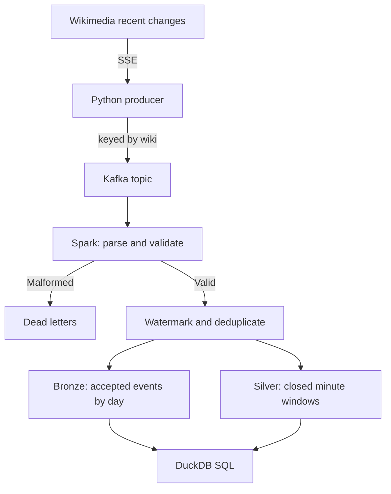

# Wikipedia streaming lakehouse

[](https://github.com/VasilenData/wiki-stream-lakehouse/actions/workflows/ci.yml)
[](LICENSE)

A local streaming data pipeline for Wikimedia's public recent-change feed. Python sends parsed events to Kafka; Spark Structured Streaming writes accepted events and minute-level aggregates to Parquet, which DuckDB queries with SQL. Terraform defines an AWS storage and query target; it has not been deployed.

## What it demonstrates

| Problem | How it is handled | Proof |
|---|---|---|
| Events arrive late | Event-time processing with a 2-minute watermark; records older than the watermark are dropped before bronze and silver | [Integration test](tests/test_e2e.py) sends late events in a later batch and checks they are excluded |
| Producer retries and replays create duplicates | Idempotent producer plus `dropDuplicatesWithinWatermark` on the event id, within the retained state | The same test sends 3 duplicates and checks they count once |
| Malformed Kafka messages | Parsing failures go to a dead-letter folder | The test sends 2 malformed messages and checks both land there |
| Checkpoint reuse | Each Parquet sink resumes its offsets and state from its own checkpoint | The test runs two `--once` invocations with the same checkpoint directory |
| Proposed AWS cost controls | Lifecycle rules, a per-query Athena scan limit and a budget alert, defined in Terraform | [Configuration](infra/terraform) passes validation in CI; no AWS deployment has been tested |



## Measured results

Run on a 17-core cloud VM with a single Kafka broker, Spark in local mode with 2 threads, on the live feed (2026-10-31):

* The producer sent **5,897 events in 200 seconds (29.5 per second)** and skipped 67 unusable events.
* The Spark job read all of it in one pass in **about 11 seconds** once Spark had started.
* **5,897 events landed in bronze**, matching the producer's reported count for this run.
* Bronze and silver together took **218 KB** of Parquet for those 5,897 events.
* Query on the result: `categorize` events were 46% of the traffic, edits 38%, and in this window the busiest sites were a Wikisource (100% bot edits), Wikimedia Commons and Wikidata.

Silver only contains windows that have closed (the watermark has passed their end). A one-off run with `--once` therefore leaves the newest minutes out of silver by design. Bronze contains accepted events after parsing, watermarking and deduplication; it can contain recent events whose silver windows are still open. Late records and duplicates dropped by the stateful operator are not retained in bronze or sent to dead letters.

## A design detail worth knowing

Spark advances the watermark between micro-batches, not inside one. An event that would be late relative to a newer timestamp in the *same* batch can still be counted if it is within the watermark used for that batch. The end-to-end test therefore sends late events in a second invocation, after the first has advanced the watermark. This is a local/CI test of that scenario.

## Delivery and recovery scope

- **Bronze is an accepted-event layer.** It is not an archive of every raw feed event or Kafka message. The producer skips events it cannot normalize, malformed Kafka messages go to dead letters, and Spark drops duplicates and records older than its watermark before writing bronze.
- **Deduplication is bounded.** `dropDuplicatesWithinWatermark` keeps state within the configured watermark horizon; the test covers its three injected duplicates, not arbitrary replays after that state has expired.
- **Checkpoints belong to each sink.** Reusing them lets the tested two-invocation scenario resume Kafka offsets and state. Bronze, silver and dead letters are separate streaming queries with separate checkpoints, so this is not an atomic commit across all three outputs. Crash recovery during a write is not exercised by the current integration test.
- **Kafka retention can cause gaps.** The reader currently sets `failOnDataLoss=false` in [job.py](src/wikistream/job.py). If required offsets have expired or a topic is deleted, missing records can be skipped instead of failing the query. The checkpoint-reuse test keeps the required Kafka data available; it does not test retention loss or broker outages.
- **The live feed is not a durable replay log here.** [producer.py](src/wikistream/producer.py) reconnects to the SSE feed without persisting an event cursor. The measured count match is one observation, not an end-to-end lossless-delivery guarantee through a disconnection.

For a stricter deployment, define a raw-event retention policy, alert on Kafka lag and missing offsets, and test process crashes and source interruptions before expanding these guarantees.

## Run it

```bash
pip install -r requirements.txt
scripts/start_kafka.sh                               # local Kafka, needs Java 17
PYTHONPATH=src python -m wikistream.producer --seconds 120
PYTHONPATH=src python -m wikistream.job --once       # or without --once to keep streaming
PYTHONPATH=src python -m wikistream.analytics top_wikis
```

Tests: `PYTHONPATH=src pytest tests/test_schema.py` (fast) and `KAFKA_BOOTSTRAP=localhost:9092 PYTHONPATH=src pytest tests/test_e2e.py` (real Kafka and Spark).

## AWS (Terraform)

`infra/terraform` defines a private, encrypted, versioned S3 bucket with lifecycle rules, Glue tables with partition projection (no crawler needed), an Athena workgroup that cancels queries scanning more than 10 GB, a least-privilege IAM policy for the job, and a monthly budget alert.

Status: the configuration passes `terraform fmt` and `terraform validate` and is checked in CI. **It has not been applied to a real AWS account**, so treat it as reviewed code, not a deployed system. To deploy: copy `terraform.tfvars.example` to `terraform.tfvars`, set your email, then `terraform init && terraform plan`.

Rough storage cost: at the measured rate (about 2.5 million events a day, a few GB of Parquet a month) S3 storage costs cents per month at AWS list prices. Check current AWS pricing before relying on this.

## Limits and next steps

* One broker and Spark in local mode: this proves the logic, not cluster-scale throughput. The feed (about 30 events a second) is far below what Kafka and Spark can handle, so the 11-second figure says nothing about their limits.
* Plain Parquet, not Iceberg or Delta, so no table-level ACID or schema evolution yet. Adding Iceberg is the natural next step.
* The streaming job is not yet deployed on EMR or Glue.
