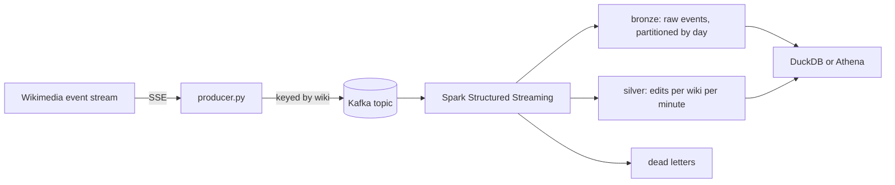

# Wikipedia streaming lakehouse

[](https://github.com/VasilenData/wiki-stream-lakehouse/actions/workflows/ci.yml)
[](LICENSE)

A streaming data pipeline on a live public feed: every edit made on Wikipedia and its sister sites, about 30 events a second, flows through Kafka into Spark Structured Streaming and lands in a Parquet lakehouse that DuckDB (locally) or Athena (on AWS) can query with SQL. Infrastructure for AWS is written as Terraform.

## What it demonstrates

| Problem | How it is handled | Proof |
|---|---|---|
| Events arrive late | Event-time windows with a 2-minute watermark | `tests/test_e2e.py` sends late events and checks they are dropped |
| Producer retries and replays create duplicates | Idempotent producer plus `dropDuplicatesWithinWatermark` on the event id | The same test sends 3 duplicates and checks they count once |
| Bad records | Rejected into a dead-letter folder instead of crashing the job | The test sends 2 malformed messages and checks both land there |
| Job restarts | Checkpoints plus file sinks give exactly-once output | The test runs two batches on one checkpoint |
| Cost | Lifecycle rules, a per-query Athena scan limit and a budget alert, all in Terraform | `infra/terraform` |



## Measured results

Run on a 17-core cloud VM with a single Kafka broker, Spark in local mode with 2 threads, on the live feed (2026-10-31):

* The producer sent **5,897 events in 200 seconds (29.5 per second)** and skipped 67 unusable events.
* The Spark job read all of it in one pass in **about 11 seconds** once Spark had started.
* **5,897 events landed in bronze: no loss and no duplicates**, matching what the producer sent.
* Bronze and silver together took **218 KB** of Parquet for those 5,897 events.
* Query on the result: `categorize` events were 46% of the traffic, edits 38%, and in this window the busiest sites were a Wikisource (100% bot edits), Wikimedia Commons and Wikidata.

Silver only contains windows that have closed (the watermark has passed their end). A one-off run with `--once` therefore leaves the newest minutes out of silver by design; bronze has everything. This is the standard append-mode trade-off.

## A design detail worth knowing

Spark advances the watermark between micro-batches, not inside one. Late events that arrive in the *same* batch as the event that moves the watermark are still counted. The end-to-end test therefore sends the late events in a second batch, which is how it behaves in production.

## Run it

```bash
pip install -r requirements.txt
scripts/start_kafka.sh                               # local Kafka, needs Java 17
PYTHONPATH=src python -m wikistream.producer --seconds 120
PYTHONPATH=src python -m wikistream.job --once       # or without --once to keep streaming
PYTHONPATH=src python -m wikistream.analytics top_wikis
```

Tests: `PYTHONPATH=src pytest tests/test_schema.py` (fast) and `KAFKA_BOOTSTRAP=localhost:9092 PYTHONPATH=src pytest tests/test_e2e.py` (real Kafka and Spark).

## AWS (Terraform)

`infra/terraform` defines a private, encrypted, versioned S3 bucket with lifecycle rules, Glue tables with partition projection (no crawler needed), an Athena workgroup that cancels queries scanning more than 10 GB, a least-privilege IAM policy for the job, and a monthly budget alert.

Status: the configuration passes `terraform fmt` and `terraform validate` and is checked in CI. **It has not been applied to a real AWS account**, so treat it as reviewed code, not a deployed system. To deploy: copy `terraform.tfvars.example` to `terraform.tfvars`, set your email, then `terraform init && terraform plan`.

Rough storage cost: at the measured rate (about 2.5 million events a day, a few GB of Parquet a month) S3 storage costs cents per month at AWS list prices. Check current AWS pricing before relying on this.

## Limits and next steps

* One broker and Spark in local mode: this proves the logic, not cluster-scale throughput. The feed (about 30 events a second) is far below what Kafka and Spark can handle, so the 11-second figure says nothing about their limits.
* Plain Parquet, not Iceberg or Delta, so no table-level ACID or schema evolution yet. Adding Iceberg is the natural next step.
* The streaming job is not yet deployed on EMR or Glue.
