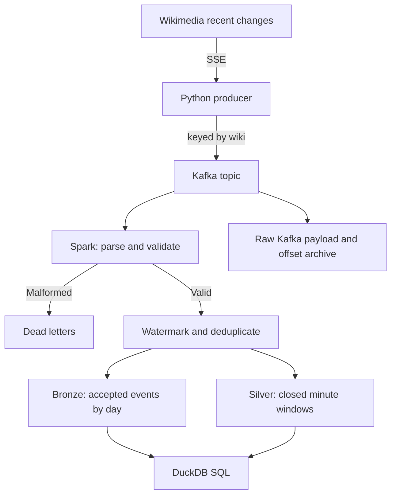

# Wikipedia streaming lakehouse

[](https://github.com/VasilenData/wiki-stream-lakehouse/actions/workflows/ci.yml)
[](LICENSE)

A local streaming data pipeline for Wikimedia's public recent-change feed. Python sends parsed events to Kafka; Spark Structured Streaming writes accepted events and minute-level aggregates to Parquet, which DuckDB queries with SQL. Terraform defines an AWS storage and query target; it has not been deployed.

## What it demonstrates

| Problem | How it is handled | Proof |
|---|---|---|
| Events arrive late | Event-time processing with a 2-minute watermark; records older than the watermark are dropped before bronze and silver | [Integration test](tests/test_e2e.py) sends late events in a later batch and checks they are excluded |
| Producer retries and replays create duplicates | Idempotent producer plus `dropDuplicatesWithinWatermark` on `(wiki, id)`, within the retained state | The same test sends 3 duplicates and deliberately reuses IDs across two wikis |
| Malformed Kafka messages | Parsing failures go to a dead-letter folder | The test sends 2 malformed messages and checks both land there |
| Recovery and committed reads | Sinks resume their checkpoints; DuckDB reads only files listed in Spark commit metadata | Integration coverage includes SIGKILL at an observed in-flight batch and missing offsets; unit tests exclude orphan files |
| Raw capture and replay | `raw_kafka` retains key/value bytes, timestamps and topic/partition/offset before parsing | Integration counts include duplicate, late and malformed messages; replay tests preserve bytes and check acknowledgements |
| Proposed AWS cost controls | Lifecycle rules, a per-query Athena scan limit and a budget alert, defined in Terraform | [Configuration](infra/terraform) passes validation in CI; no AWS deployment has been tested |



## Measured results

Historical run, before raw archival and commit-aware reading were added: a 17-core cloud VM with a single Kafka broker, Spark in local mode with 2 threads, on the live feed (2026-10-31):

* The producer sent **5,897 events in 200 seconds (29.5 per second)** and skipped 67 unusable events.
* The Spark job read all of it in one pass in **about 11 seconds** once Spark had started.
* **5,897 events landed in bronze**, matching the producer's reported count for this run.
* Bronze and silver together took **218 KB** of Parquet for those 5,897 events.
* Query on the result: `categorize` events were 46% of the traffic, edits 38%, and in this window the busiest sites were a Wikisource (100% bot edits), Wikimedia Commons and Wikidata.

These figures have not been remeasured for the new archive and recovery path. Silver only contains windows that have closed (the watermark has passed their end). A one-off run with `--once` therefore leaves the newest minutes out of silver by design. Bronze contains accepted events after parsing, watermarking and deduplication; it can contain recent events whose silver windows are still open. Late records and duplicates dropped by the stateful operator are not retained in bronze or sent to dead letters; their original Kafka payloads are retained by the separate raw sink.

## A design detail worth knowing

Spark advances the watermark between micro-batches, not inside one. An event that would be late relative to a newer timestamp in the *same* batch can still be counted if it is within the watermark used for that batch. The end-to-end test therefore sends late events in a second invocation, after the first has advanced the watermark. This is a local/CI test of that scenario.

## Delivery and recovery scope

- **Bronze is an accepted-event layer.** It is not an archive of every raw feed event or Kafka message. The producer skips events it cannot normalize, malformed Kafka messages go to dead letters, and Spark drops duplicates and records older than its watermark before writing bronze.
- **Deduplication is bounded.** `dropDuplicatesWithinWatermark` keeps state within the configured watermark horizon; the test covers its three injected duplicates, not arbitrary replays after that state has expired.
- **Event IDs are scoped to a wiki.** The [Wikimedia schema](https://github.com/wikimedia/mediawiki-event-schemas/blob/master/jsonschema/mediawiki/recentchange/current.yaml) identifies `id` as the recent-change ID and `wiki` as the database identity. The deduplication key includes both, so equal numeric IDs on different wikis survive.
- **Queued is not delivered.** The producer counts delivery callbacks and exits with an error if Kafka reports a delivery failure or messages remain after the final flush. Unit tests inject these outcomes without a broker. This does not make the upstream SSE connection replayable.
- **Checkpoints belong to each sink.** Raw Kafka, bronze, silver and dead letters are separate streaming queries with separate checkpoints, not an atomic commit across outputs. The crash test starts with a completed batch, observes a new offset-log entry without its commit, kills the process group and resumes. It verifies new-record recovery, unique Kafka offsets and accepted event keys. This is one controlled local failure scenario, not proof of every storage/broker failure.
- **Missing Kafka offsets fail closed.** [job.py](src/wikistream/job.py) defaults to `failOnDataLoss=true`. Integration coverage recreates a source topic with fewer offsets and requires failure on resume. `--allow-data-loss` explicitly opts into Spark's skip behavior; it is not a repair.
- **Files on disk are not necessarily committed.** [files.py](src/wikistream/files.py) reads Spark 3.5 v1 `_spark_metadata` logs, including compact snapshots and delete actions. DuckDB and replay use that committed set, excluding orphan Parquet files. Missing files, log gaps, unsupported versions and paths outside the sink fail closed. This reader supports local files only; stop writers for a stable multi-sink inspection. It does not provide a cross-sink snapshot.
- **The live feed is not a durable replay log here.** [producer.py](src/wikistream/producer.py) reconnects to the SSE feed without persisting an event cursor. The measured count match is one observation, not an end-to-end lossless-delivery guarantee through a disconnection.

The implementation follows Spark [3.5.3 file-sink commit semantics](https://github.com/apache/spark/blob/v3.5.3/sql/core/src/main/scala/org/apache/spark/sql/execution/streaming/FileStreamSinkLog.scala) and [Kafka source options](https://github.com/apache/spark/blob/v3.5.3/docs/structured-streaming-kafka-integration.md). Retention policies, lag alerting, durable SSE cursor recovery and storage/power-failure drills remain deployment work. Raw Kafka archives messages committed to that sink, not events lost before Kafka.

## Run it

```bash
pip install -r requirements.txt
scripts/start_kafka.sh                               # local Kafka, needs Java 17
PYTHONPATH=src python -m wikistream.producer --seconds 120
PYTHONPATH=src python -m wikistream.job --once       # or without --once to keep streaming
PYTHONPATH=src python -m wikistream.analytics top_wikis
```

After upgrading from the old ID-only deduplication key or the pre-archive output schemas, use a **new checkpoint and output directory** together, for example `--checkpoint checkpoints-wiki-id --out lake-wiki-id`. Do not reuse the previous state or append a replay into its old outputs. The previous directories can be retained for comparison.

Tests: `PYTHONPATH=src pytest tests/test_schema.py tests/test_producer.py` (fast) and `KAFKA_BOOTSTRAP=localhost:9092 PYTHONPATH=src pytest tests/test_e2e.py` (real Kafka and Spark).

## Measured broker-outage exercise

The separate CI `broker-recovery` job deliberately kills its disposable Kafka
3.7.1 process while Spark is running, queues synthetic traffic while the broker
is unavailable, and restarts the same broker with its existing log directory.
It keeps the Spark output and checkpoints. If Spark exits, the exercise runner
performs at most one checkpoint restart and records that action; this is an
exercise supervisor, not a deployed recovery service.

The fixture sends 28 records: 22 distinct valid events, three intentional
duplicates within the watermark horizon, and three malformed records. Delivery
callbacks supply the acknowledged Kafka offsets independently of the sinks.
The assertions require every acknowledged offset exactly once in the raw
archive, all 22 accepted keys exactly once in bronze, and exactly the three
rejected offsets in dead letters. Counts alone cannot hide a missing record
replaced by a duplicate.

Each run uploads `broker-recovery.json` plus Spark and broker logs as a 30-day
Actions artifact. The JSON records observed broker downtime, broker restart
time, time from restart until all expected committed rows are visible, missing
acknowledged offsets and duplicate counts. Failed exercises retain a failure
report instead of claiming a recovery time. Consult a successful run's artifact
for measured numbers; no timing is asserted here before execution.

This is a **single-node, retained-disk process-failure exercise**. It does not
establish high availability, recovery after disk loss, or lossless Wikimedia SSE
ingestion. The local producer queue remains alive during the outage, and Kafka
acknowledgments are the lower bound of the recovery claim. It is separate from
the Spark in-flight crash test and from historical throughput measurements.

To run locally on Linux with Java 17, use a fresh **disposable** broker directory
and a free port 9092; the start script initializes that directory's Kafka data:

```bash
bash scripts/start_kafka.sh "$PWD/.outage-broker"
KAFKA_BOOTSTRAP=localhost:9092 KAFKA_OUTAGE_TEST_DIR="$PWD/.outage-broker" \
  WIKISTREAM_RECOVERY_ARTIFACT_DIR=recovery-evidence PYTHONPATH=src \
  pytest -q -s tests/test_broker_outage.py
```

The test verifies that the recorded PID belongs to the supplied Kafka config
before killing it. Do not use a broker or data directory shared with other work.

## Replay an archived capture

Stop the writer, retain its output and checkpoints, then use a separate Kafka
topic and new output/checkpoint directories:

```bash
PYTHONPATH=src python -m wikistream.replay --archive lake/raw_kafka --topic wikimedia-replay
PYTHONPATH=src python -m wikistream.job --topic wikimedia-replay --out replay-lake --checkpoint replay-checkpoints --once
```

The topic must exist or the broker must allow automatic topic creation. Replay
uses committed raw files, preserves key/value bytes and fails on incomplete
delivery. An interrupted replay can enqueue a partial prefix; repeating it is
not an exactly-once replay transaction. Original offsets, partition assignment,
micro-batch boundaries and cross-partition order are not reproduced. Re-batching
can change which records pass a watermark, so identical silver aggregates are
not guaranteed. No live-feed measurement was regenerated for this feature.

## AWS (Terraform)

`infra/terraform` defines a private, encrypted, versioned S3 bucket with lifecycle rules, Glue tables with partition projection (no crawler needed), an Athena workgroup that cancels queries scanning more than 10 GB, a least-privilege IAM policy for the job, and a monthly budget alert.

Status: the configuration passes `terraform fmt` and `terraform validate` and is checked in CI. **It has not been applied to a real AWS account**, so treat it as reviewed code, not a deployed system. To deploy: copy `terraform.tfvars.example` to `terraform.tfvars`, set your email, then `terraform init && terraform plan`.

Rough storage cost: at the measured rate (about 2.5 million events a day, a few GB of Parquet a month) S3 storage costs cents per month at AWS list prices. Check current AWS pricing before relying on this.

## Limits and next steps

* One broker and Spark in local mode: this proves the logic, not cluster-scale throughput. The feed (about 30 events a second) is far below what Kafka and Spark can handle, so the 11-second figure says nothing about their limits.
* Plain Parquet, not Iceberg or Delta, so no table-level ACID or schema evolution yet. Adding Iceberg is the natural next step.
* The streaming job is not yet deployed on EMR or Glue.
